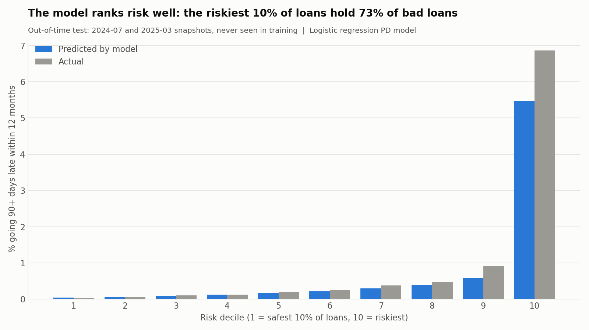
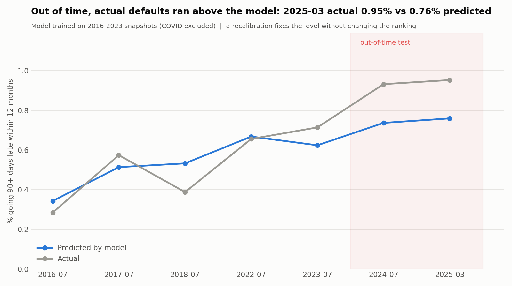

# Mortgage Credit Risk Analysis & Stress Testing

Credit risk analysis of **250,000 Freddie Mac mortgages** (5 origination vintages, 50K loans each), from raw loan-level files to a vintage analysis, a 12-month expected-loss model and a stress test under the **Federal Reserve's 2026 severely adverse scenario**.

**[Live Tableau dashboard](https://public.tableau.com/app/profile/anushka.gupta8497/viz/MortgageCreditRiskDashboard/MortgageCreditRisk)**


---

## Headline finding

**The 2023 vintage is the main risk in this book.** Four separate methods point to it:

| Method | What it shows for the 2023 vintage |
|---|---|
| Vintage curves | At the same loan age it goes 90+ days late faster than every other vintage except 2019 (the COVID vintage) |
| Calendar view | It is the vintage with the highest share of loans 90+ days late **today**: 1.24%, up from 0.87% a year earlier |
| Expected loss | It is 40% of the balance but **54% of the 12-month expected loss** |
| Stress test | 52% of its loans go underwater if house prices fall 30%. That makes it **62% of the stressed loss** |

Loans written in 2023 were made at peak house prices with high rates, so borrowers have the least equity cushion and the least room in their budgets.

## Key numbers

| | |
|---|---|
| Active book (Mar 2026) | $25.8B, 114,860 loans |
| Loans 90+ days late today | 0.75%, **2.1x** two years ago (0.36%) |
| 12-month expected loss (point-in-time) | **$11.7M** (4.5 bps of balance) |
| Expected loss in a Fed severe recession | **$128.6M** (49.8 bps), **11x** baseline |
| 2-year cumulative stressed loss | $227.6M (0.88% of balance) |
| Loss severity (loss / balance at default) | 23.7% overall |
| PD model, out-of-time test (2024–25) | **AUC 0.90, Gini 0.80, KS 0.64** vs 0.76 AUC for the old segment PD |
| 12-month EL with loan-level scorecard PD | **$12.5M** (4.85 bps); 2023 vintage = **60%** of it |

---

## Questions answered

### 1. Do some vintages perform worse than others? (`vintage_curves.py`)
Cumulative % of loans ever 90+ days late, by months since origination. At age 24 months, **2019 loans were about 5.2x the median of the other vintages**, because COVID hit them in their second year.


### 2. Was COVID a vintage problem or a calendar problem? (`calendar_d90.py`)
Plotting the same data by **calendar month** shows every vintage on the books spiked in the same months, whatever its age. Portfolio 90+ days late went from 0.19% (Dec 2019) to 2.95% (Sep 2020). That is a **systemic shock**, not bad underwriting.


### 3. How do loans move between delinquency states? (`roll_rate.py`)
Month-to-month transition (roll-rate) matrix, normal times vs COVID (Apr 2020 to Dec 2021):

| Transition | Normal | COVID |
|---|---|---|
| 30 days late → 60 | 15.5% | 37.7% |
| 60 days late → 90+ | 37.1% | 64.1% |
| 90+ days late → Default | 1.06% | 0.09% |

Late loans rolled forward much faster in COVID, but almost none defaulted, because the **foreclosure moratorium and forbearance** froze the last step.

### 4. Which borrower traits drive risk? (`risk_drivers.py`)
"Lift" = segment's 24-month 90+ late rate ÷ portfolio rate.

- FICO < 620: **4.45x**
- LTV 96–100: **2.45x**
- DTI 44–50: **1.65x**

The risk layers. Across a FICO × LTV grid the 90+ late rate runs from **0.26% (780+, LTV ≤70) to 7.42% (<680, LTV >90), about 29x**.


### 5. How much is lost when a loan defaults? (`lgd.py`)
Severity is measured from actual loss data on 485 loss events:

| Segment | Severity |
|---|---|
| All | 23.7% |
| Judicial foreclosure states | 30.8% |
| Non-judicial states | 19.6% |
| With mortgage insurance | 15.9% |
| Without mortgage insurance | 28.8% |

Only **11.8%** of resolved 90+ late loans end in a loss. Most cure, refinance or sell. This is measured on resolved loans only, because loans still active might yet default (right-censoring). The naive figure over all loans is 5.7%.

### 6. What is the expected loss? (`pd_model.py`, `expected_loss.py`)
`EL = PD × LGD × EAD`, built loan by loan:

- **PD**: 12-month snapshot PD by FICO × LTV segment. Through-the-cycle 0.70%. COVID window 3.54% (~5x). Loans already 90+ late get PD = 100%.
- **LGD**: D90→loss conversion × severity by LTV band.
- **EAD**: current unpaid balance.

Result: **$11.7M (4.5 bps)**. **50% of it comes from just 861 loans already 90+ days late.**

### 7. What happens in a severe recession? (`stress_test.py`)
Uses the **Fed 2026 severely adverse scenario**: unemployment 4.5% → 10%, house prices −30%. Each shock is applied one at a time, so the result is a waterfall:

| Step | 12-month EL | Added |
|---|---|---|
| Baseline | $11.7M | |
| + Unemployment (COVID-observed PD multiplier per segment) | $34.6M | +$23.0M |
| + Negative equity (underwater loans: PD × 2) | $45.8M | +$11.2M |
| + More late loans end in foreclosure (11.8% → 26.7%) | $104.2M | +$58.3M |
| + Lower recovery (house prices −30%) | **$128.6M** | +$24.5M |

**Half of the increase comes from late loans ending in foreclosure, not from more loans going late.** Underwater loans go from 369 to 22,927 (20% of the book).

Sensitivity on the two softest assumptions (negative-equity multiplier 1–3x, unemployment shock 0.5–1.5x COVID) gives a range of **$63M – $221M**.


### 8. Can a statistical model predict default, and did its predictions come true? (`pd_features.py`, `pd_logit.py`, `pd_backtest.py`)
A **logistic regression PD scorecard** on 688K loan-snapshots. Every feature is banded (scorecard style) so each band's effect is readable as an odds ratio. Features are only what was known **at the snapshot** (no look-ahead): FICO, LTV, DTI, current LTV, loan age, number of borrowers, occupancy, MI, current delinquency and worst delinquency in the prior 12 months.

**Out-of-time validation**: trained on 2016–2023 snapshots (COVID excluded), tested on 2024-07 and 2025-03 snapshots the model never saw.

| Model | Test AUC | Gini | KS |
|---|---|---|---|
| **Logistic regression scorecard** | **0.901** | **0.80** | **0.64** |
| Old FICO × LTV segment PD (benchmark) | 0.756 | 0.51 | 0.39 |
| Gradient boosting (challenger) | 0.899 | 0.80 | 0.64 |

The explainable model matches the ML challenger, so nothing is lost by choosing it.

- **Behaviour beats origination**: a loan that was 60–90 days late in the last year has **~20x** the odds of a never-late loan. FICO < 660 is 3.6x vs FICO 740–779; a single borrower is 1.9x vs two.
- **Ranking holds on the hardest loans**: among loans current and never late in the last year (no delinquency history to lean on), AUC is still **0.78** (old segment PD: 0.73).
- **Riskiest 10% of loans hold 73% of bad loans** in the test period.

**Backtest: the model under-predicts recent risk.** In both test snapshots actual defaults ran **~26% above** prediction (0.95% actual vs 0.76% predicted in 2025-03). The miss is concentrated in recent vintages: **2023 loans defaulted at 1.39x** what their borrower profile predicts (2012 and 2016 vintages: within 4%). So the 2023 vintage is riskier than its FICO, LTV and DTI explain, which is consistent with the headline finding. One likely driver is payment affordability at high rates, which these features do not capture.

**Recalibration**: scaling the model's odds to match the 2024-07 snapshot (×1.27) and checking on 2025-03 brings the prediction from 0.76% to **0.91%** (actual 0.95%) without changing the ranking. Banks call this a point-in-time calibration.




### 9. What changes when every loan gets its own PD? (`el_scorecard.py`)
The scorecard is refit on all seven normal snapshots, calibrated point-in-time to the latest one (odds ×1.09 so the 2025-03 prediction matches the actual 0.95%), and used to score each of the 114,860 active loans with its features as of Mar 2026. Loans already 90+ days late keep PD = 100%, as before.

| | Segment PD (FICO × LTV) | Scorecard PD (loan level) |
|---|---|---|
| 12-month expected loss | $11.7M (4.52 bps) | **$12.5M (4.85 bps)** |
| Riskiest 10% of performing loans carry | 29% of performing-loan EL | **79%** |
| 1,432 loans 30–60 days late today: average PD | 1.9% | **34.9%** |

- **The total barely moves (+7%), but where the risk sits changes completely.** The segment PD gives a loan that is 60 days late the same PD as a clean loan in its FICO × LTV cell. The scorecard moves risk onto the loans that are actually slipping: the median performing loan's PD falls to 0.4x its segment PD.
- **1,432 loans 30–60 days late are an early-warning list.** The segment approach sees them at 1.9%; the scorecard at 35%, before they reach 90 days.
- **By vintage**: seasoned, clean books fall (2012 −46%, 2016 −20%) and the **2023 vintage rises 19%**, to **60% of expected loss** (from 54%) at 7.2 bps.

The stress test still runs on the segment PD; moving it onto the scorecard is the natural next step.

---

## Method notes

- **Default proxy**: ever 90+ days late, including REO acquisition and zero-balance codes 02/03/09 (third-party sale, short sale, REO).
- **Observation-window bias**: newer vintages have had less time to go bad, so vintages are compared on **90+ late within 24 months**, not "ever".
- **Missing-value codes** (FICO 9999, LTV/DTI 999, etc.) are converted to NULL before any analysis.
- **NULL trap**: `BOOL_OR` over all-NULL rows returns NULL and `AVG` skips it. This first showed forbearance at 78–95%. Wrapping it in `COALESCE(..., FALSE)` gave the real 1–7%.
- **TTC vs PIT**: through-the-cycle PD pools all normal snapshots. Point-in-time uses the latest (Jul 2024, Mar 2025).
- **Thin bands merged in the scorecard**: DTI > 50 (31 loans, zero bad) caused perfect separation and a non-converging fit, and FICO < 620 (2.5K loans) came out less risky than 620–659. Both were merged into neighbours so risk is monotonic across bands.
- **Stressed conversion** uses the 2012 vintage (post-crisis, many underwater HARP loans) as the closest in-sample analogue of a falling-house-price world.

## Limitations

- Freddie Mac's **sample** files (50K loans per vintage), not the full dataset.
- Stress multipliers are calibrated on COVID, when forbearance stopped defaults. A recession without forbearance would probably be worse.
- Only 485 loss events, so severity by small segments is noisy.
- The PD model's features do not include payment shock or the borrower's rate versus market rates, which likely explains part of its under-prediction for recent vintages.
- No macro regression model; the stress test applies observed multipliers and stated assumptions (all constants at the top of `stress_test.py`).

---

## Project structure

| Step | Script | Output |
|---|---|---|
| Load raw files into DuckDB | `load_data.py` | `mortgage.duckdb` |
| Clean + flag | `clean_views.py`, `loan_summary.py` | `orig_clean`, `perf_clean`, `loan_summary` |
| Vintage analysis | `vintage_curves.py`, `plot_vintage_curves.py`, `calendar_d90.py` | curves, calendar view |
| Roll rates | `roll_rate.py` | transition matrix |
| Risk drivers | `risk_drivers.py`, `plot_risk_drivers.py` | lift chart, FICO × LTV grid |
| LGD | `lgd.py` | severity by segment |
| PD + Expected loss | `pd_model.py`, `expected_loss.py` | EL by segment and vintage |
| Stress test | `stress_test.py`, `plot_stress.py` | waterfall, vintage, sensitivity |
| PD scorecard + backtest | `pd_features.py`, `pd_logit.py`, `pd_backtest.py` | coefficients, AUC/Gini/KS, calibration charts |
| Scorecard PD in EL | `el_scorecard.py` | loan-level EL, segment vs scorecard by vintage |
| Dashboard data | `tableau_prep.py` | `outputs/tableau/tableau_data.xlsx` |

All CSVs and charts are in [`outputs/`](outputs/).

## How to run

1. Register and download the **Single-Family Loan-Level Dataset sample files** from [Freddie Mac](https://www.freddiemac.com/research/datasets/sf-loanlevel-dataset) for 2012, 2016, 2019, 2021 and 2023. Unzip them into `data/raw/`. The data is not included in this repo because of Freddie Mac's terms of use.
2. Install:
   ```bash
   pip install -r requirements.txt
   ```
3. Run the scripts in the order of the table above:
   ```bash
   python load_data.py
   python clean_views.py
   python loan_summary.py
   # ... through tableau_prep.py
   ```

Runs on a laptop (built on a MacBook Air M2, 8GB RAM). DuckDB queries the monthly performance files (millions of rows) directly, with no database server needed.

## Tools

Python · DuckDB (SQL) · pandas · statsmodels · scikit-learn · matplotlib · Tableau Public

## Data source

Freddie Mac Single-Family Loan-Level Dataset. Stress scenario: [Federal Reserve 2026 supervisory stress test scenarios](https://www.federalreserve.gov/newsevents/pressreleases/bcreg20260204a.htm).
