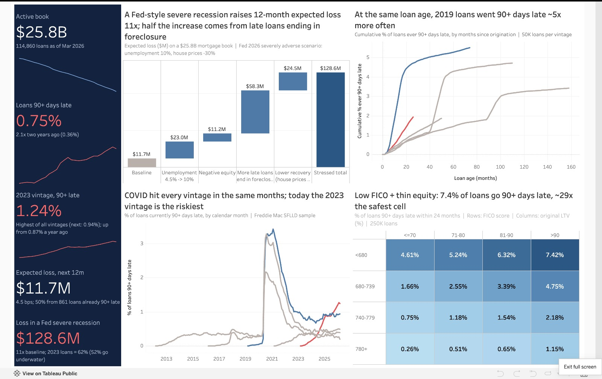
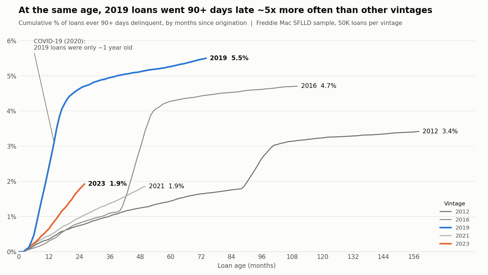
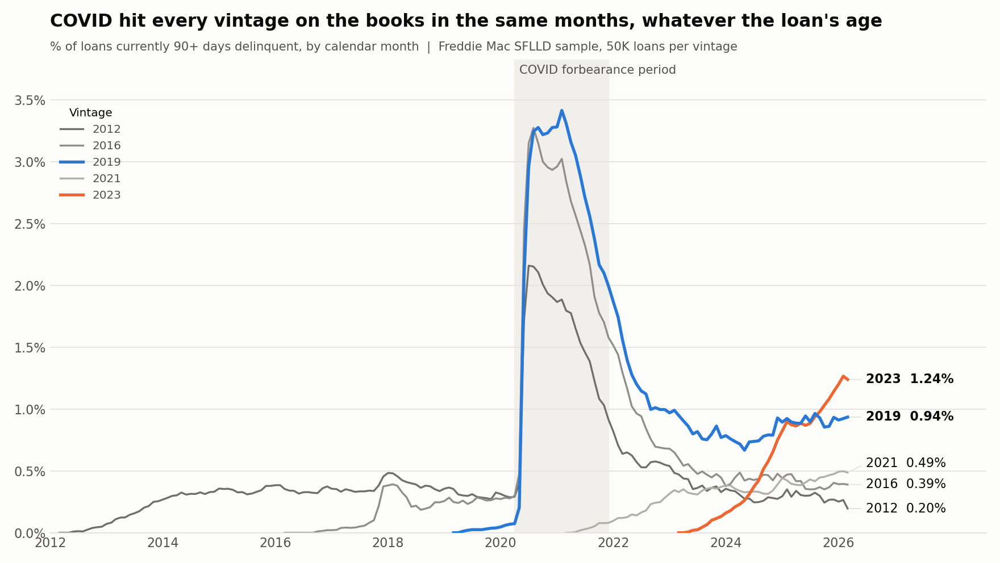
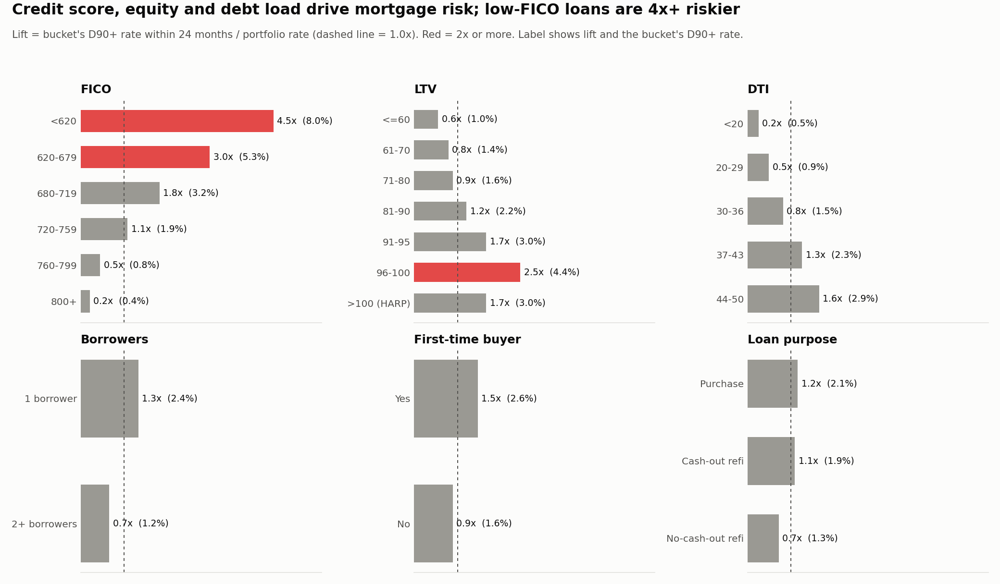
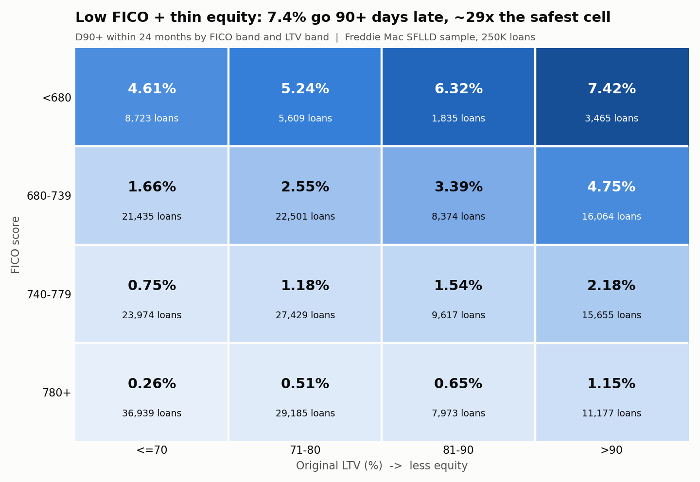
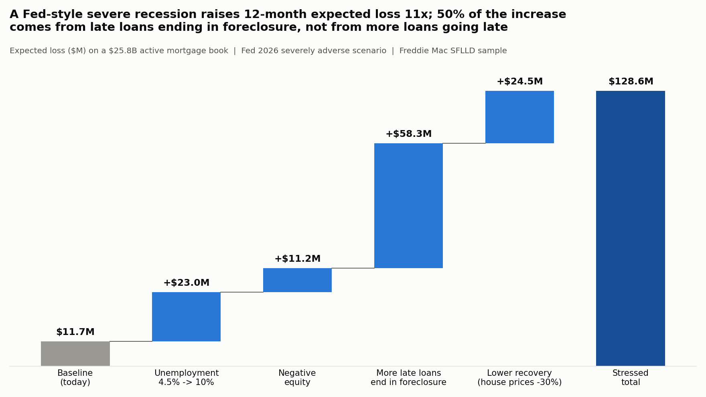
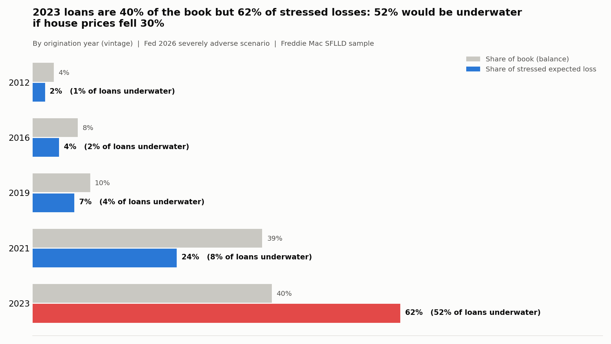

# Mortgage Credit Risk Analysis & Stress Testing

Credit risk analysis of **250,000 Freddie Mac mortgages** (5 origination vintages, 50K loans each), from raw loan-level files to a vintage analysis, a 12-month expected-loss model and a stress test under the **Federal Reserve's 2026 severely adverse scenario**.

**[Live Tableau dashboard](https://public.tableau.com/app/profile/anushka.gupta8497/viz/MortgageCreditRiskDashboard/MortgageCreditRisk)**



---

## Headline finding

**The 2023 vintage is the main risk in this book.** Four separate methods point to it:

| Method | What it shows for the 2023 vintage |
|---|---|
| Vintage curves | At the same loan age it goes 90+ days late faster than every other vintage except 2019 (the COVID vintage) |
| Calendar view | It is the vintage with the highest share of loans 90+ days late **today**: 1.24%, up from 0.87% a year earlier |
| Expected loss | It is 40% of the balance but **54% of the 12-month expected loss** |
| Stress test | 52% of its loans go underwater if house prices fall 30%. That makes it **62% of the stressed loss** |

Loans written in 2023 were made at peak house prices with high rates, so borrowers have the least equity cushion and the least room in their budgets.

## Key numbers

| | |
|---|---|
| Active book (Mar 2026) | $25.8B, 114,860 loans |
| Loans 90+ days late today | 0.75%, **2.1x** two years ago (0.36%) |
| 12-month expected loss (point-in-time) | **$11.7M** (4.5 bps of balance) |
| Expected loss in a Fed severe recession | **$128.6M** (49.8 bps), **11x** baseline |
| 2-year cumulative stressed loss | $227.6M (0.88% of balance) |
| Loss severity (loss / balance at default) | 23.7% overall |

---

## Questions answered

### 1. Do some vintages perform worse than others? (`vintage_curves.py`)
Cumulative % of loans ever 90+ days late, by months since origination. At age 24 months, **2019 loans were about 5.2x the median of the other vintages**, because COVID hit them in their second year.



### 2. Was COVID a vintage problem or a calendar problem? (`calendar_d90.py`)
Plotting the same data by **calendar month** shows every vintage on the books spiked in the same months, whatever its age. Portfolio 90+ days late went from 0.19% (Dec 2019) to 2.95% (Sep 2020). That is a **systemic shock**, not bad underwriting.



### 3. How do loans move between delinquency states? (`roll_rate.py`)
Month-to-month transition (roll-rate) matrix, normal times vs COVID (Apr 2020 to Dec 2021):

| Transition | Normal | COVID |
|---|---|---|
| 30 days late → 60 | 15.5% | 37.7% |
| 60 days late → 90+ | 37.1% | 64.1% |
| 90+ days late → Default | 1.06% | 0.09% |

Late loans rolled forward much faster in COVID, but almost none defaulted, because the **foreclosure moratorium and forbearance** froze the last step.

### 4. Which borrower traits drive risk? (`risk_drivers.py`)
"Lift" = segment's 24-month 90+ late rate ÷ portfolio rate.

- FICO < 620: **4.45x**
- LTV 96–100: **2.45x**
- DTI 44–50: **1.65x**

The risk layers. Across a FICO × LTV grid the 90+ late rate runs from **0.26% (780+, LTV ≤70) to 7.42% (<680, LTV >90), about 29x**.




### 5. How much is lost when a loan defaults? (`lgd.py`)
Severity is measured from actual loss data on 485 loss events:

| Segment | Severity |
|---|---|
| All | 23.7% |
| Judicial foreclosure states | 30.8% |
| Non-judicial states | 19.6% |
| With mortgage insurance | 15.9% |
| Without mortgage insurance | 28.8% |

Only **11.8%** of resolved 90+ late loans end in a loss. Most cure, refinance or sell. This is measured on resolved loans only, because loans still active might yet default (right-censoring). The naive figure over all loans is 5.7%.

### 6. What is the expected loss? (`pd_model.py`, `expected_loss.py`)
`EL = PD × LGD × EAD`, built loan by loan:

- **PD**: 12-month snapshot PD by FICO × LTV segment. Through-the-cycle 0.70%. COVID window 3.54% (~5x). Loans already 90+ late get PD = 100%.
- **LGD**: D90→loss conversion × severity by LTV band.
- **EAD**: current unpaid balance.

Result: **$11.7M (4.5 bps)**. **50% of it comes from just 861 loans already 90+ days late.**

### 7. What happens in a severe recession? (`stress_test.py`)
Uses the **Fed 2026 severely adverse scenario**: unemployment 4.5% → 10%, house prices −30%. Each shock is applied one at a time, so the result is a waterfall:

| Step | 12-month EL | Added |
|---|---|---|
| Baseline | $11.7M | |
| + Unemployment (COVID-observed PD multiplier per segment) | $34.6M | +$23.0M |
| + Negative equity (underwater loans: PD × 2) | $45.8M | +$11.2M |
| + More late loans end in foreclosure (11.8% → 26.7%) | $104.2M | +$58.3M |
| + Lower recovery (house prices −30%) | **$128.6M** | +$24.5M |

**Half of the increase comes from late loans ending in foreclosure, not from more loans going late.** Underwater loans go from 369 to 22,927 (20% of the book).

Sensitivity on the two softest assumptions (negative-equity multiplier 1–3x, unemployment shock 0.5–1.5x COVID) gives a range of **$63M – $221M**.




---

## Method notes

- **Default proxy**: ever 90+ days late, including REO acquisition and zero-balance codes 02/03/09 (third-party sale, short sale, REO).
- **Observation-window bias**: newer vintages have had less time to go bad, so vintages are compared on **90+ late within 24 months**, not "ever".
- **Missing-value codes** (FICO 9999, LTV/DTI 999, etc.) are converted to NULL before any analysis.
- **NULL trap**: `BOOL_OR` over all-NULL rows returns NULL and `AVG` skips it. This first showed forbearance at 78–95%. Wrapping it in `COALESCE(..., FALSE)` gave the real 1–7%.
- **TTC vs PIT**: through-the-cycle PD pools all normal snapshots. Point-in-time uses the latest (Jul 2024, Mar 2025).
- **Stressed conversion** uses the 2012 vintage (post-crisis, many underwater HARP loans) as the closest in-sample analogue of a falling-house-price world.

## Limitations

- Freddie Mac's **sample** files (50K loans per vintage), not the full dataset.
- Stress multipliers are calibrated on COVID, when forbearance stopped defaults. A recession without forbearance would probably be worse.
- Only 485 loss events, so severity by small segments is noisy.
- No macro regression model; the stress test applies observed multipliers and stated assumptions (all constants at the top of `stress_test.py`).

---

## Project structure

| Step | Script | Output |
|---|---|---|
| Load raw files into DuckDB | `load_data.py` | `mortgage.duckdb` |
| Clean + flag | `clean_views.py`, `loan_summary.py` | `orig_clean`, `perf_clean`, `loan_summary` |
| Vintage analysis | `vintage_curves.py`, `plot_vintage_curves.py`, `calendar_d90.py` | curves, calendar view |
| Roll rates | `roll_rate.py` | transition matrix |
| Risk drivers | `risk_drivers.py`, `plot_risk_drivers.py` | lift chart, FICO × LTV grid |
| LGD | `lgd.py` | severity by segment |
| PD + Expected loss | `pd_model.py`, `expected_loss.py` | EL by segment and vintage |
| Stress test | `stress_test.py`, `plot_stress.py` | waterfall, vintage, sensitivity |
| Dashboard data | `tableau_prep.py` | `outputs/tableau/tableau_data.xlsx` |

All CSVs and charts are in [`outputs/`](outputs/).

## How to run

1. Register and download the **Single-Family Loan-Level Dataset sample files** from [Freddie Mac](https://www.freddiemac.com/research/datasets/sf-loanlevel-dataset) for 2012, 2016, 2019, 2021 and 2023. Unzip them into `data/raw/`. The data is not included in this repo because of Freddie Mac's terms of use.
2. Install:
   ```bash
   pip install -r requirements.txt
   ```
3. Run the scripts in the order of the table above:
   ```bash
   python load_data.py
   python clean_views.py
   python loan_summary.py
   # ... through tableau_prep.py
   ```

Runs on a laptop (built on a MacBook Air M2, 8GB RAM). DuckDB queries the monthly performance files (millions of rows) directly, with no database server needed.

## Tools

Python · DuckDB (SQL) · pandas · matplotlib · Tableau Public

## Data source

Freddie Mac Single-Family Loan-Level Dataset. Stress scenario: [Federal Reserve 2026 supervisory stress test scenarios](https://www.federalreserve.gov/newsevents/pressreleases/bcreg20260204a.htm).
